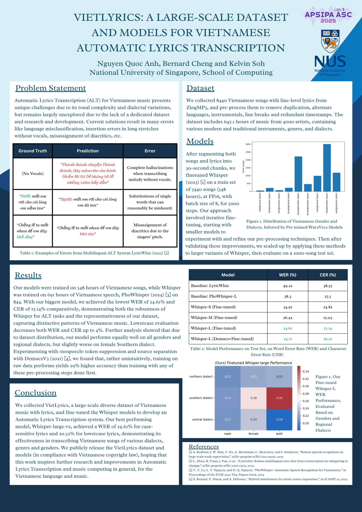

*A big thank you to my fellow researchers Bernard Cheng and Kelvin Soh. A **smaller but just as meaningful** thank you to Nguyen Thi Minh Thu, for helping us navigate the wonderful world of Vietnam copyright law.*

Spawning from a research project in *NUS Music and Sound Computing* class, we released our [**paper**](https://arxiv.org/abs/2510.22295) through [***APSIPA 2025***](https://www.apsipa2025.org/wp/), soon to be published in the official conference proceedings. We also release our finetuned Whisper [**models**](https://huggingface.co/collections/kelvinbksoh/vietnamese-automated-lyrics-transcription) and our collected [**dataset**](https://github.com/BatmanofZuhandArrgh/VietLyrics) of 647 hours of songs and lyrics. 

And if you're not keen on reading the whole paper, here's a summary:

    

VietLyrics poster as part of APSIPA 2025
